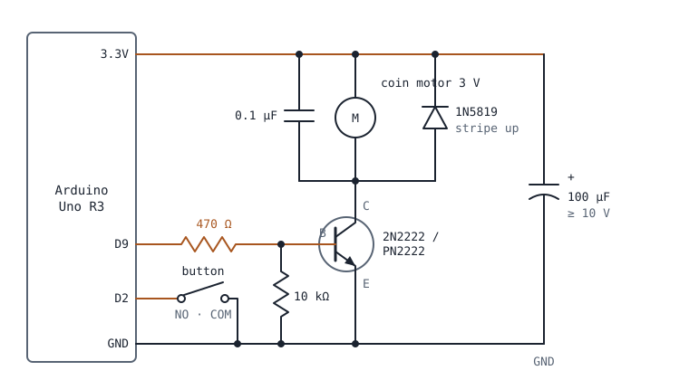

# Hardware build guide: fingertip motor (Arduino Uno R3)

Everything needed to build and test the physical part of Open Canvas.

> **Oct 24: the describe button is dropped.** Resting the finger still on a spot for ~2.5 s
> speaks its description instead. Skip every button step (step 11, bench test 3, section 7) and
> leave D2 unwired; the firmware sends nothing when D2 is unconnected. Motor works live.

- **EE #2:** sections 1–5 (circuit, breadboard build, flashing, bench test)
- **BME:** section 6 (finger mount), plus section 5's last test

**Board:** we're racing two boards. This guide is the **Arduino Uno R3**
(`firmware/open_canvas_uno/`); the ESP32 version lives in `firmware/open_canvas_esp32/`.
Both use the same serial protocol, so the laptop works with either one.

---

## 1. What it does

- **Motor:** a coin vibration motor on the fingertip **buzzes when the finger crosses an
  outline** between two objects in the painting. Edges are felt, not heard (CLAUDE.md section 6).
- **Button:** **press and hold** for a spoken description of the spot under the finger.

The laptop does all the heavy work (camera, hand tracking, audio) and decides *when* to buzz.
It can't switch a motor or read a button by itself, so the Uno sits in between over USB:

| Direction | Message | Meaning |
|---|---|---|
| laptop → Uno | `M1` / `M0` | motor on / off |
| Uno → laptop | `B1` / `B0` | button pressed / released (debounced 25 ms, sent only on change) |

115200 baud, one message per line. Pins: **motor D9, button D2, motor power from 3.3V**.

---

## 2. Schematic



The transistor is a **low-side switch**: it sits between the motor and ground. A small current
into its base (from D9) lets the larger motor current flow from 3.3V, through the motor, to GND.

---

## 3. Parts

| Part | Value | Qty | Purpose |
|---|---|---|---|
| NPN transistor | 2N2222 or PN2222 (2N3904 also OK) | 1 | Switches the motor. A Uno pin can't supply the ~80 mA the motor draws. |
| Base resistor | **470 Ω** (yellow-violet-brown) | 1 | Limits D9's current into the base to ~9 mA. |
| Pull-down resistor | **10 kΩ** (brown-black-orange) | 1 | Holds the base at 0 V while the Uno resets (every time the laptop connects), so the motor doesn't twitch. |
| Flyback diode | 1N5819 (1N4148 or 1N4001 also OK) | 1 | Absorbs the voltage spike when the motor turns off. **Required**: protects the transistor and the Uno. |
| Bulk capacitor | 100 µF electrolytic, ≥ 10 V | 1 | Covers the current surge when the motor starts so the Uno doesn't reset. **Polarized.** |
| Ceramic capacitor | 0.1 µF (marked "104") | 1 | Across the motor terminals; filters brush noise. Optional. |
| Vibration motor | DIANN 3 V coin ERM | 1 (+ spares) | The fingertip buzz. |
| Arcade button | EG STARTS 30 mm, COM + NO terminals | 1 | Describe button. |
| Wire to the finger | 26–28 AWG **stranded** silicone, ~1 m, two colors | 1 pair | Motor leads break easily; stranded wire survives finger movement. |
| Heat-shrink, breadboard, jumpers | | | |

**Why these values** (motor current assumed ~80 mA; measure yours if you can):

- Base current: `(5 V − 0.7 V) / 470 Ω ≈ 9.1 mA`. Uno pins are 5 V; 0.7 V is the base-emitter drop.
  220 Ω (the ESP32 value) would give 19.5 mA, right at the Uno's 20 mA per-pin recommendation.
- Fully on? `I_C / I_B ≈ 80 / 9.1 ≈ 9`, far below the transistor's gain (100+), so it saturates
  with only ~0.2 V across it. The motor gets ~3.1 V.
- Supply: the Uno R3's 3.3 V regulator gives ~150 mA, enough for one coin motor.
  **Don't use 5V**: it overdrives a 3 V motor.
- The pull-down only takes `4.3 V / 10 kΩ ≈ 0.4 mA` of the base current. Negligible.

---

## 4. Breadboard build (EE #2)

**USB unplugged the whole time you're building.**

1. **Check the transistor's pin order first.** Read the part number on its flat face and look up
   the datasheet. With the flat face toward you and legs down, many PN2222s are **E-B-C** left to
   right, but many 2N2222s are **C-B-E**. Getting it backwards won't damage anything at these
   currents; the motor just won't buzz.
2. **Rails:** Uno **3.3V** → breadboard **+ rail** (red wire). Uno **GND** → **− rail** (black wire).
3. **Transistor:** place it so each leg is in its own row. Call them the E, B and C rows.
4. **Emitter:** E row → − rail.
5. **Base resistor:** 470 Ω from the B row to an empty row; a jumper from that row to Uno **D9**.
6. **Pull-down:** 10 kΩ from the B row to the − rail.
7. **Motor:** one motor lead → + rail, the other → C row. (A coin ERM spins either way, so its
   lead polarity doesn't matter for buzzing.)
8. **Flyback diode:** **stripe end → + rail**, other end → C row. Backwards, it shorts the motor
   path when the transistor turns on: the motor won't buzz and the diode gets hot.
9. **0.1 µF ceramic:** + rail → C row (in parallel with the motor). Not polarized.
10. **100 µF electrolytic:** **long leg (+) → + rail, striped leg (−) → − rail.** Keep it close
    to the motor. Backwards, an electrolytic can bulge or pop.
11. **Button:** **COM** → − rail, **NO** → Uno **D2**. No resistor needed: the firmware turns on
    the Uno's internal pull-up, so the pin reads HIGH when released and LOW when pressed.

Before plugging in: trace each wire against the schematic, and check that nothing connects the
+ rail straight to the − rail.

---

## 5. Flash and test (EE #2)

The Uno on Gerson's Mac is already flashed. To flash another Uno:

```bash
# Arduino IDE: open firmware/open_canvas_uno/open_canvas_uno.ino, Board = Arduino Uno, Upload
# or from the terminal (macOS: brew install arduino-cli)
arduino-cli core install arduino:avr
arduino-cli compile --fqbn arduino:avr:uno firmware/open_canvas_uno
arduino-cli upload -p /dev/cu.usbmodem101 --fqbn arduino:avr:uno firmware/open_canvas_uno
```

Bench test, in order. Open the Arduino Serial Monitor at **115200** baud with **Newline** line endings.

1. **Boot:** you should see `OPEN_CANVAS READY UNO motor=D9 button=D2`.
2. **Motor:** type `M1` → the motor buzzes **and** the onboard **L** LED turns on. `M0` → both off.
   - LED on but no buzz → check the transistor pin order, the diode direction, and the motor wires.
   - Uno resets when the motor starts → the 100 µF capacitor is missing, backwards or too far away.
3. **Button:** press and release → exactly one `B1`, then one `B0`. Doubles mean the debounce
   needs raising (`DEBOUNCE_MS` in the sketch).
4. **No twitch at startup:** close and reopen the Serial Monitor (this resets the Uno). The motor
   must stay still. If it twitches, check the 10 kΩ pull-down.
5. **Full system** (with Gerson, on the demo Mac, Serial Monitor closed):
   `python -m app.main --serial /dev/cu.usbmodem101`. Trace an outline in the painting:
   it should buzz at each edge, and resting the finger still ~2.5 s should speak a description.
6. **Soak:** 5 minutes of normal use, no resets and no hot parts.

---

## 6. Finger mount (BME)

Goals: the user's **fingertip pad stays bare** (they're feeling the paper), the **camera can
still see the fingertip**, and the motor's buzz is clearly felt.

- **Where:** on the **back of the finger, on the middle segment** (between the two knuckle
  joints), not on the nail. The camera tracks the very tip of the finger from above, and
  anything bulky on the nail can throw off where it thinks the tip is. The vibration still
  carries clearly to the fingertip.
- **How:** an adjustable strap so it fits any visitor: a Velcro strip or elastic band with the
  motor's adhesive back stuck to it. No gloves or finger cots over the tip (they hide the
  tip from the camera and block touch).
- **Strain relief:** heat-shrink over the joint where the motor's leads meet the stranded wire,
  then tape or a second strap at the **wrist** so a tug on the cable pulls the wrist, not the
  motor. The motor's original leads are very thin and break at the motor body.
- **Cable:** twisted pair, about 1 m, running along the back of the hand to the wrist and then
  to the breadboard. Leave enough slack to reach every corner of the print.
- **Comfort and hygiene:** a skin-friendly surface against the finger; it gets worn by many
  testers, so make it wipeable or swappable.
- **Check:** with the system running, rest the finger on an edge. The buzz should be obvious
  but not uncomfortable. If it's weak, report it; we can try a different motor or position.

## 7. Button placement (BME): dropped Oct 24, skip

- Fix the button so it **can't slide**: in a small box or a hole in stiff cardboard (30 mm hole),
  taped to the table.
- Put it on the side of the **non-exploring hand**, at a consistent spot a blind user can find by
  touch, and show them where it is before they start.
- Leave room so the button's wires don't cross the painting or the camera's view.

---

## 8. Quick troubleshooting

| Symptom | Likely cause |
|---|---|
| L LED follows `M1`/`M0` but no buzz | Transistor pins wrong, diode backwards, motor lead not in the C row |
| Motor always on | Motor's lower lead in the − rail instead of the C row, or the C row shorted to GND |
| Weak buzz | Transistor C and E swapped (it half-works backwards), or motor on a long thin wire run |
| Uno resets when the motor starts | 100 µF missing or backwards |
| Motor twitches on connect | 10 kΩ pull-down missing |
| `B1 B0 B1 B0` from one press | Button bounce: raise `DEBOUNCE_MS` to 30–40 |
| Nothing in the Serial Monitor | Wrong port, or wrong baud (must be 115200) |
| Hot diode | Diode backwards (stripe must face the + rail) |
| Hot transistor | A short, or the base resistor missing (D9 straight to the base) |
